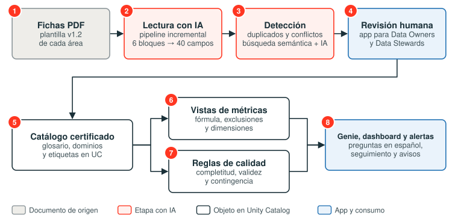

# Guía de la demo: del documento al indicador certificado

En esta guía les acompañamos a reproducir la demo de punta a punta y, sobre todo, a entender qué hace cada etapa, por
qué la diseñamos así y qué capacidad de Azure Databricks usa. Todo corre en cómputo serverless y queda gobernado en
Unity Catalog.

## 1. Qué vamos a construir



| Componente | En una frase |
|---|---|
| **Lectura de fichas** | Un pipeline incremental analiza cada PDF y convierte sus 6 bloques en 40 columnas. |
| **Detección** | La búsqueda semántica encuentra fichas parecidas y un modelo de lenguaje explica si son duplicados o conflictos. |
| **Revisión humana** | Una app web donde los Data Owners y Stewards (`grupo_aprobadores`) deciden y aprueban; cada decisión queda auditada. |
| **Publicación** | Catálogo con estados (certificado, pendiente de aprobación, en revisión, devuelto, retirado), glosario, homologación de vocabulario, dominios y etiquetas en Unity Catalog. |
| **Vistas de métricas** | Cada indicador certificado se implementa una vez con su fórmula, exclusiones y dimensiones autorizadas. |
| **Calidad** | Las reglas del Bloque 5 se ejecutan en cada carga; si falla la regla de contingencia, el indicador se marca en pausa y se alerta. |
| **Consumo** | Dos agentes de Genie (catálogo e indicadores), un dashboard y alertas. |

## 2. Preparación

1. **Desplegar el bundle** en el destino `demo`. En `databricks.yml`, dentro del destino `demo`, reemplacen los ocho
   valores marcados con `<...>`: `workspace.host`, `catalogo`, `warehouse_id`, `correo_alertas` (correo de un usuario
   del workspace) y los cuatro grupos. Los cuatro grupos deben ser **grupos de la cuenta** (no grupos locales del workspace); para una demo pueden ser el
   mismo grupo: `grupo_revisores` (consumidores), `grupo_aprobadores` (usan la app de revisión), `grupo_stewards`
   (aprueban vistas y reglas) y `grupo_operacion` (costos y auditoría):

   ```bash
   cd bundle
   databricks bundle validate -t demo
   databricks bundle deploy -t demo
   ```

   El destino `demo` usa `mode: development`: los jobs y el pipeline aparecen con el prefijo `[dev <su_usuario>]`.

2. **Permisos necesarios** para quien ejecuta la demo (si no es administrador del workspace y del metastore):
   - `USE CATALOG` y `CREATE SCHEMA` sobre el catálogo (o propiedad de los esquemas `indicadores_*`).
   - `CAN USE` sobre el SQL warehouse; permiso para crear endpoints de AI Search y apps.
   - `CAN QUERY` sobre los endpoints `modelo_llm` y `modelo_embeddings`.
   - `ASSIGN` sobre la etiqueta de sistema `system.certification_status` (certificación de tablas y vistas).
   - `USE CATALOG system`, `USE SCHEMA` y `SELECT` sobre `system.billing.usage`, `system.billing.list_prices`,
     `system.lakeflow.job_run_timeline` y `system.access.table_lineage` (notebook 10).

   La lista completa, en SQL, está en la guía `03` (sección 3.2).
3. **Ejecutar la demo completa** (crea todo desde cero) y después iniciar la app de revisión:

   ```bash
   databricks bundle run -t demo demo_completa
   databricks bundle run -t demo revision_indicadores   # inicia la app de revisión
   ```

   El job ejecuta las etapas en el orden de esta guía. Pueden seguirlo en *Jobs & Pipelines* → *[dev <su_usuario>]
   Gobierno de indicadores · Demo completa (desde cero)*. En el destino `demo`, las vistas de métricas, las reglas de calidad y los
   indicadores sin hallazgos se aprueban automáticamente (`modo_vistas_de_metricas = generar`,
   `aprobar_reglas_automaticamente = si`, `aprobar_indicadores_automaticamente = si`); en producción los aprueban el Data
   Steward y los Data Owners (guía `03`, sección 4).

## 3. Paso a paso

### Paso 0 — Preparar el entorno (`00_preparar_entorno`)

- **Qué hace:** crea los esquemas `<prefijo>_landing`, `_fuentes`, `_bronze`, `_silver` y `_gold`, y el volumen
  `fichas_indicadores` con las carpetas `recibidas/` y `exportaciones/`.
- **Por qué:** separar capas permite dar permisos distintos (las áreas solo escriben en el volumen; los consumidores solo
  leen `gold`) y reprocesar una capa sin tocar las demás.
- **Capacidad:** [Unity Catalog](https://learn.microsoft.com/es-es/azure/databricks/data-governance/unity-catalog/) y [volúmenes](https://learn.microsoft.com/es-es/azure/databricks/volumes/).
- **Qué deben ver:** `SHOW SCHEMAS IN <mi_catalogo> LIKE 'indicadores_*'` devuelve los 5 esquemas.

### Paso 1 — Fichas sintéticas (`01_generar_fichas_sinteticas`)

- **Qué hace:** genera 62 fichas PDF con la misma plantilla (versión 1.2) en 9 dominios. La ficha IND-001 es el ejemplo
  original de la plantilla. Incluye a propósito 8 duplicados, 6 conflictos y 4 fichas incompletas, y guarda la respuesta
  esperada en `indicadores_landing.respuesta_esperada_fichas_sinteticas` para medir la detección.
- **Por qué:** necesitamos casos reales que resolver. En producción este paso no existe: las fichas reales llegan al volumen.
- **Qué deben ver:** 62 archivos `.pdf` en `/Volumes/<mi_catalogo>/indicadores_landing/fichas_indicadores/recibidas/`.

### Paso 2 — Datos de los sistemas de origen (`02_generar_datos_fuentes`)

- **Qué hace:** crea `tbl_citas_master` (≈120 mil citas de 12 meses), `cat_sucursales` y `tbl_cartera_mensual`
  (20 mil créditos × 12 cortes), con comentarios de columna. Incluye los problemas que describen las reglas de calidad:
  estatus nulos, valores fuera del catálogo, duplicados por reintentos de carga y asistencias registradas tarde.
- **Por qué:** para convertir los indicadores en vistas de métricas y ejecutar sus reglas de calidad sobre datos.
- **Capacidad:** tablas Delta administradas por [Unity Catalog](https://learn.microsoft.com/es-es/azure/databricks/data-governance/unity-catalog/) con
  [comentarios de columna](https://learn.microsoft.com/es-es/azure/databricks/sql/language-manual/sql-ref-syntax-ddl-comment) (el diccionario que usan la IA y Genie).
- **Qué deben ver:** la consulta final del notebook muestra el porcentaje de estatus nulos (≈1.5%) y la tasa de asistencia.

### Paso 3 — Lectura de las fichas (pipeline *Lectura de fichas*)

- **Qué hace:**
  1. `bronze.fichas_parseadas`: con [Auto Loader](https://learn.microsoft.com/es-es/azure/databricks/ingestion/cloud-object-storage/auto-loader/) lee solo los PDF nuevos y los analiza con [`ai_parse_document`](https://learn.microsoft.com/es-es/azure/databricks/sql/language-manual/functions/ai_parse_document) (texto, tablas e imágenes; en nuestras pruebas también reconoció la casilla marcada del tipo de indicador; valídenlo con sus fichas).
  2. `silver.fichas_estructuradas`: [`ai_extract`](https://learn.microsoft.com/es-es/azure/databricks/sql/language-manual/functions/ai_extract) versión 2.1 con el esquema `config/esquema_ficha.json` convierte los 6 bloques en columnas; [`ai_classify`](https://learn.microsoft.com/es-es/azure/databricks/sql/language-manual/functions/ai_classify) sugiere el dominio por el concepto.
  3. `silver.fichas_vigentes`: la última versión de cada ficha con indicadores de completitud y [expectativas](https://learn.microsoft.com/es-es/azure/databricks/ldp/expectations) (`tiene_data_owner`, `tiene_origen_de_datos`, `tiene_formula_con_variables`…).
- **Por qué:** las áreas redactan distinto y la plantilla cambia; un esquema de extracción es más robusto que reglas de
  texto. El pipeline es incremental: cada PDF se procesa una sola vez.
- **Capacidad:** [Lakeflow Spark Declarative Pipelines](https://learn.microsoft.com/es-es/azure/databricks/ldp/).
- **Qué deben ver:**

  ```sql
  SELECT id_indicador, nombre, tipo_indicador, data_owner, formula, tabla_origen, size(dimensiones) AS dimensiones
  FROM <mi_catalogo>.indicadores_silver.fichas_vigentes ORDER BY id_indicador;
  ```

  62 filas, sin `error_extraccion`. En la página del pipeline, la pestaña de calidad muestra cuántas fichas no cumplen
  cada expectativa.
- **Errores comunes:** modelo de IA no disponible en la región; ver la guía `05`.

### Paso 4 — Duplicados, conflictos e incompletas (`04_detectar_duplicados_y_conflictos`)

- **Qué hace:** crea un índice de [AI Search (antes Vector Search)](https://learn.microsoft.com/es-es/azure/databricks/ai-search/ai-search) con el texto de cada ficha (nombre,
  definición, variables, fórmula, exclusiones); para cada ficha busca las 5 más parecidas; los pares con similitud
  ≥ `umbral_similitud` los evalúa un modelo de lenguaje con [`ai_query`](https://learn.microsoft.com/es-es/azure/databricks/sql/language-manual/functions/ai_query) y
  salida estructurada (relación, diferencias, justificación, recomendación, ficha sugerida como oficial). Agrega a la
  cola las fichas incompletas y los dominios a confirmar.
- **Por qué:** con 600 fichas hay ≈180 mil pares; la búsqueda semántica reduce el trabajo a los pares parecidos, y
  encuentra duplicados aunque usen otro nombre.
- **Qué deben ver:**

  ```sql
  SELECT tipo_hallazgo, estado, count(*) FROM <mi_catalogo>.indicadores_gold.hallazgos_revision GROUP BY ALL;
  ```

  En la demo se detectan los 14 pares plantados y la IA propone además algunos pares adicionales que el revisor
  descarta o confirma (por ejemplo, una "Tasa de Retención" que en realidad mide renovaciones).

### Paso 5 — Revisión humana (app *revision-indicadores*)

- **Qué hace:** la app muestra la cola por prioridad, compara las fichas lado a lado con la explicación de la IA y
  registra la decisión (unificar, definir oficial, mantener ambas, escalar al comité, devolver al área, confirmar
  dominio) en `gold.decisiones_revision` con el usuario y la fecha.
- **Por qué:** unificar un indicador cambia reportes y metas de un área: la decisión es de una persona y queda auditada.
- **Capacidad:** [Databricks Apps](https://learn.microsoft.com/es-es/azure/databricks/dev-tools/databricks-apps/).
- **En la demo**, el notebook `05_simular_revision` registra decisiones automáticas para que el flujo termine solo, y
  deja **pendientes** dos conflictos (Tasa de Aprobación y Tasa de Retención) y el dominio del Índice de Morosidad, para
  resolverlos en vivo. Abran la app desde *Compute* → *Apps* → *revision-indicadores*. Tiene cuatro pestañas: *Cola de revisión*,
  *Aprobar indicadores* (el Data Owner aprueba los indicadores sin hallazgos), *Catálogo publicado* e *Historial de decisiones*.

### Paso 6 — Publicación (`06_publicar_catalogo_y_glosario`)

- **Qué hace:** calcula el estado de cada ficha y publica `gold.catalogo_indicadores` (con sinónimos de las fichas
  unificadas), `gold.glosario_negocio` (términos, reglas de homologación y definiciones oficiales),
  `gold.reglas_homologacion`, `gold.uso_vocabulario_no_homologado`, `gold.dominios`; aplica etiquetas de dominio y de
  responsables y la certificación (`system.certification_status`) (los permisos los aplica el Paso 12); deja una exportación Markdown por dominio
  para *Pages*.
- **Por qué:** es la fuente única de verdad: cada indicador tiene un estado y, si fue unificado, apunta al oficial;
  las etiquetas y la certificación hacen visible en todo Unity Catalog qué es oficial y a qué dominio pertenece.
- **Capacidad:** [certificación](https://learn.microsoft.com/es-es/azure/databricks/data-governance/unity-catalog/certify-deprecate-data) y [etiquetas](https://learn.microsoft.com/es-es/azure/databricks/database-objects/tags) ·
  [ai_query](https://learn.microsoft.com/es-es/azure/databricks/sql/language-manual/functions/ai_query) (homologación de vocabulario).
- **Qué deben ver:**

  ```sql
  SELECT estado_certificacion, count(*) FROM <mi_catalogo>.indicadores_gold.catalogo_indicadores GROUP BY ALL;
  SELECT termino, sinonimos FROM <mi_catalogo>.indicadores_gold.glosario_negocio WHERE tipo_entrada = 'HOMOLOGACION';
  ```

  Un indicador sin hallazgos pendientes queda **CERTIFICADO** solo si su Data Owner lo aprobó (en producción, en la
  pestaña *Aprobar indicadores*; en la demo, de forma automática); si no, queda **PENDIENTE_APROBACION**.
  IND-001 aparece **CERTIFICADO** con "Tasa de Asistencia a Citas en Sucursal" como sinónimo; "Contacto Origen" aparece
  como término oficial que unifica "Lead Comercial", "Prospecto de Campaña" y "Registro Telefónico".

### Paso 7 — Vistas de métricas (`07_generar_vistas_de_metricas`)

- **Qué hace:** para cada tabla de origen mapeada en `config/mapeo_fuentes.json`, un modelo propone las medidas
  (fórmula + exclusiones + reglas de validez) y dimensiones (las autorizadas en el Bloque 6, más mes y fecha); cada
  expresión **se ejecuta** contra la tabla antes de usarla; se crean `gold.mv_citas_telemarketing` y
  `gold.mv_cartera_credito` con `CREATE VIEW ... WITH METRICS LANGUAGE YAML` (versión 1.1, con nombres visibles y
  sinónimos) y la vista `gold.serie_mensual_indicadores`. Cada versión queda en `gold.definicion_vistas_de_metricas`
  (historial). En la demo (modo `generar`) la versión se aprueba y publica en el mismo paso; en producción (modo
  `proponer`) se crea `<vista>_propuesta` sin certificar y la vista oficial solo cambia cuando el Data Steward aprueba
  la nueva versión y se ejecuta `publicar_vistas_aprobadas`.
- **Por qué:** el indicador se define una sola vez y lo consumen dashboards, Genie, alertas y SQL; la aprobación evita
  que una definición certificada cambie sin revisión.
- **Capacidad:** [vistas de métricas](https://learn.microsoft.com/es-es/azure/databricks/uc-semantics/metric-views/).
- **Qué deben ver:** en Catalog Explorer, la vista con sus medidas y dimensiones y la pestaña *Lineage*; y:

  ```sql
  SELECT mes, MEASURE(tasa_conversion_cita_efectiva) FROM <mi_catalogo>.indicadores_gold.mv_citas_telemarketing
  GROUP BY ALL ORDER BY mes;
  ```

  (el nombre exacto de cada medida está en `gold.vistas_de_metricas_vigentes`).

### Paso 8 — Reglas de calidad (`08_reglas_de_calidad`)

- **Qué hace:** convierte el Bloque 5 de cada indicador certificado en reglas (`gold.reglas_calidad`: completitud,
  validez, unicidad, oportunidad, contingencia), evalúa las reglas **aprobadas** con SQL fijo sobre la última carga y
  publica `gold.resultados_calidad` y `gold.estado_publicacion_indicadores`. Los fragmentos SQL propuestos por la IA
  (`filtro`, `condicion_valida`) solo se aceptan si usan columnas de la tabla y operadores simples.
- **Por qué:** las reglas que las áreas escriben en el Bloque 5 se vuelven controles automáticos; el protocolo de
  contingencia deja de depender de que alguien revise a mano.
- **Capacidad:** [ai_query](https://learn.microsoft.com/es-es/azure/databricks/sql/language-manual/functions/ai_query) (extracción de reglas) y
  [alertas de Databricks SQL](https://learn.microsoft.com/es-es/azure/databricks/sql/user/alerts/) (aviso de contingencia).
- **Qué deben ver:** para IND-001, completitud de `Cod_Estatus` ≥ 98% (cumple), la regla de unicidad que detecta los
  duplicados por reintentos y el indicador en estado *publicar*.

### Paso 9 — Agentes de Genie (`09_crear_agentes_genie`)

- **Qué hace:** crea *Catálogo de indicadores* (sobre el catálogo, glosario, hallazgos y fichas) e *Indicadores de
  negocio* (sobre las vistas de métricas), con instrucciones, consultas de ejemplo y preguntas de referencia; ejecuta
  cada consulta para comprobar que funciona.
- **Por qué:** es el primer paso que buscábamos: que cualquier persona pregunte en español qué indicadores existen, quién
  es su dueño o cuánto vale un indicador, con una respuesta auditable (cada respuesta muestra el SQL).
- **Capacidad:** [Genie Agents](https://learn.microsoft.com/es-es/azure/databricks/genie-agents/set-up).
- **Prueben:** "¿Qué indicadores miden la morosidad?", "¿Quién es el Data Owner de la Tasa de Conversión de Cita
  Efectiva?", "¿Qué conflictos siguen pendientes?", "¿Cuál fue la tasa de conversión de cita efectiva por canal el último
  mes?".

### Paso 10 — Costos y monitoreo (`10_costos_y_monitoreo`)

- **Qué hace:** crea `gold.costos_solucion` y muestra costo por producto, historial de ejecuciones, linaje y auditoría
  de decisiones.
- **Por qué:** para operar la solución sabiendo cuánto cuesta y quién decidió qué.
- **Capacidad:** [tablas del sistema de facturación](https://learn.microsoft.com/es-es/azure/databricks/admin/system-tables/billing) y
  [linaje](https://learn.microsoft.com/es-es/azure/databricks/data-governance/unity-catalog/data-lineage).
- **Qué deben ver:** las tablas de costo por producto y por día (los datos de facturación pueden tardar algunas horas) y
  el linaje volumen → bronze → silver → gold. Detalle en la guía `04`.

### Paso 12 — Permisos (`12_otorgar_permisos`)

En el job, este paso se ejecuta **antes** de las validaciones (Paso 11). Las validaciones no verifican permisos: revisen
`gold.avisos_publicacion` (debe estar vacía si los grupos son grupos de la cuenta) y `SHOW GRANTS` sobre el catálogo.

- **Qué hace:** otorga `SELECT` tabla por tabla sobre los objetos publicados (incluidas las vistas `mv_*`) al grupo de
  consumidores y revisores; costos, auditoría y avisos al grupo de operación; y a la app de revisión, lectura de fichas
  y escritura en la cola, las decisiones y las aprobaciones. Lo que no puede aplicar queda en `gold.avisos_publicacion`.
- **Por qué:** cada persona ve solo lo que le corresponde; Genie y los dashboards consultan con los permisos de cada usuario.
- **Capacidad:** [privilegios de Unity Catalog](https://learn.microsoft.com/es-es/azure/databricks/data-governance/unity-catalog/manage-privileges/).
- **Qué deben ver:** `SHOW GRANTS ON TABLE <mi_catalogo>.indicadores_gold.catalogo_indicadores` con el grupo de revisores.

### Paso 11 — Validaciones (`11_validaciones`)

- **Qué hace:** comprueba 10 criterios (lectura completa, fidelidad de la extracción, detección de duplicados y
  conflictos, fichas incompletas, dominio, catálogo, **vista de métricas igual a un cálculo de referencia escrito a
  mano**, calidad, homologación y agentes) y guarda el resultado en `gold.resultado_validaciones`. Si algo falla, el
  job falla.
- **Por qué:** para comprobar con datos, y no por inspección visual, que cada etapa produjo lo esperado.
- **Capacidad:** notebooks y jobs serverless con aserciones sobre tablas de Unity Catalog.
- **Qué deben ver:** `SELECT * FROM <mi_catalogo>.indicadores_gold.resultado_validaciones` con las 10 filas en `OK`.

## 4. Recorrido del resultado

1. **Dashboards**: *Gobierno de indicadores de negocio* (Catálogo, Revisión, Indicadores y calidad; para consumidores
   y revisores) y *Gobierno de indicadores · Operación* (costos, auditoría de decisiones y avisos; para el grupo de operación).
2. **App** de revisión: resolver uno de los conflictos pendientes y ver cómo cambia el catálogo al ejecutar el job
   *Publicar catálogo certificado*.
3. **Genie**: preguntas en español sobre el catálogo y sobre los indicadores.
4. **Demostraciones en vivo:**
   - `databricks bundle run -t demo demo_llega_ficha_nueva`: Cobranza envía "Porcentaje de Cartera en Mora"; en
     minutos aparece en la app como conflicto con el Índice de Morosidad.
   - `databricks bundle run -t demo demo_falla_de_calidad`: el CRM entrega una carga con 6% de estatus nulos; IND-001
     pasa a *En pausa* en `estado_publicacion_indicadores`. Las alertas se despliegan pausadas
     (`estado_alertas = PAUSED`, valor por defecto): para ver la alerta de contingencia, ábranla en *SQL* → *Alertas* y
     usen *Ejecutar ahora* (activas, se evalúa cada hora).

## 5. Limpieza del entorno de demo

```bash
databricks bundle destroy -t demo
```

Además, eliminen el endpoint de AI Search (`databricks vector-search-endpoints delete-endpoint indicadores-vs`) y los
agentes de Genie (sus identificadores están en `gold.agentes_genie`; desde la interfaz: *Genie Agents* → menú del agente →
*Mover a la papelera*, o con la API):

```bash
databricks api delete /api/2.0/genie/spaces/<space_id>
```

Y por último los esquemas:

```sql
DROP SCHEMA IF EXISTS <mi_catalogo>.indicadores_gold CASCADE;   -- repetir para _silver, _bronze, _fuentes, _landing
```
