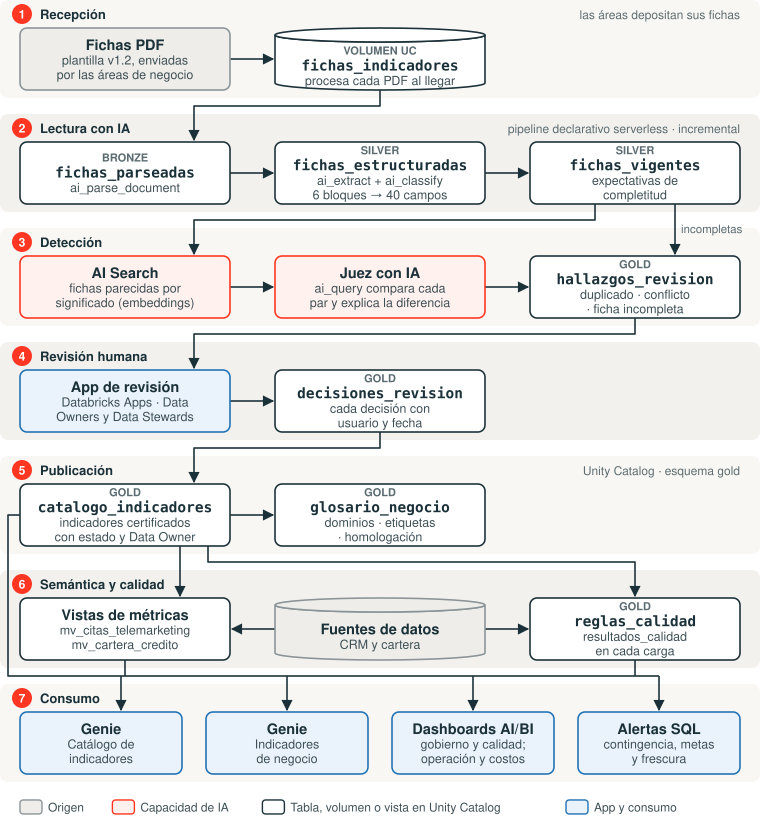

# Arquitectura y decisiones de diseño

En este documento les explicamos cómo está construida la solución de gobierno de indicadores de negocio, por qué
elegimos cada componente y qué alternativas consideramos. La idea es que puedan defender el diseño ante sus equipos
de arquitectura, seguridad y negocio, y adaptarlo con criterio a su entorno.

## 1. Arquitectura de referencia

### Capa por capa

| Capa | Qué hace | Capacidad de Databricks |
|---|---|---|
| **Recepción** | Las áreas depositan sus fichas PDF en un volumen de Unity Catalog. Un job con *file arrival trigger* procesa las fichas nuevas. | [Volúmenes](https://learn.microsoft.com/es-es/azure/databricks/volumes/) · [Desencadenadores por llegada de archivos](https://learn.microsoft.com/es-es/azure/databricks/jobs/file-arrival-triggers) |
| **Bronze** | Cada PDF se analiza una sola vez (procesamiento incremental) y se guarda su texto y estructura (tablas, encabezados, imágenes). | [ai_parse_document](https://learn.microsoft.com/es-es/azure/databricks/sql/language-manual/functions/ai_parse_document) · [Lakeflow Spark Declarative Pipelines](https://learn.microsoft.com/es-es/azure/databricks/ldp/) |
| **Silver** | Los 6 bloques de la plantilla se convierten en columnas (40 campos) con un esquema JSON; la IA sugiere el dominio por el concepto del indicador; expectativas de calidad miden la completitud de la documentación. | [ai_extract](https://learn.microsoft.com/es-es/azure/databricks/sql/language-manual/functions/ai_extract) · [ai_classify](https://learn.microsoft.com/es-es/azure/databricks/sql/language-manual/functions/ai_classify) · [Expectativas](https://learn.microsoft.com/es-es/azure/databricks/ldp/expectations) |
| **Detección** | Para cada ficha se buscan las más parecidas por significado; un modelo de lenguaje compara cada par y propone si es duplicado o conflicto, con las diferencias concretas. | [AI Search (antes Vector Search)](https://learn.microsoft.com/es-es/azure/databricks/ai-search/ai-search) · [ai_query](https://learn.microsoft.com/es-es/azure/databricks/sql/language-manual/functions/ai_query) |
| **Revisión humana** | Data Owners y Stewards resuelven cada hallazgo en una app web; cada decisión queda con usuario y fecha. | [Databricks Apps](https://learn.microsoft.com/es-es/azure/databricks/dev-tools/databricks-apps/) |
| **Gold / publicación** | Catálogo certificado, glosario y homologación de vocabulario, dominios, etiquetas y certificación en Unity Catalog. | [Etiquetas](https://learn.microsoft.com/es-es/azure/databricks/database-objects/tags) · evolución: [Etiquetas gobernadas](https://learn.microsoft.com/es-es/azure/databricks/admin/governed-tags/) y [Dominios](https://learn.microsoft.com/es-es/azure/databricks/uc-semantics/domains) |
| **Capa semántica** | Cada indicador certificado se implementa una vez como vista de métricas: fórmula, exclusiones y dimensiones autorizadas. | [Vistas de métricas](https://learn.microsoft.com/es-es/azure/databricks/uc-semantics/metric-views/) |
| **Calidad** | Las reglas del Bloque 5 se convierten en reglas ejecutables y se evalúan en cada carga de las fuentes; si falla la regla de contingencia, el indicador se marca en pausa y se alerta. | [Alertas de Databricks SQL](https://learn.microsoft.com/es-es/azure/databricks/sql/user/alerts/) |
| **Consumo** | Dos agentes de Genie para preguntar en español; un dashboard AI/BI de gobierno y calidad, y otro de operación (costos y auditoría) para un grupo restringido. | [Genie Agents](https://learn.microsoft.com/es-es/azure/databricks/genie-agents/set-up) · [Dashboards](https://learn.microsoft.com/es-es/azure/databricks/dashboards/) |

### Diagrama de la arquitectura

## 2. Decisiones de diseño

| Decisión | Alternativa considerada | Por qué recomendamos esta | Referencia |
|---|---|---|---|
| Leer las fichas con `ai_parse_document` dentro de Databricks | OCR o servicio de documentos externo | Una herramienta menos que integrar y asegurar; el documento, su texto y su linaje quedan en Unity Catalog. Reconoce texto, tablas e imágenes; en nuestras pruebas leyó también la casilla marcada de la plantilla. | [ai_parse_document](https://learn.microsoft.com/es-es/azure/databricks/sql/language-manual/functions/ai_parse_document) |
| Extraer los 6 bloques con `ai_extract` y un esquema JSON | Expresiones regulares o un parser por plantilla | Las áreas redactan distinto y la plantilla evoluciona (v1.2 hoy). El esquema JSON se versiona en `config/esquema_ficha.json`: agregar un campo es editar ese archivo. | [ai_extract](https://learn.microsoft.com/es-es/azure/databricks/sql/language-manual/functions/ai_extract) |
| Pipeline declarativo incremental | Notebook que reprocesa todo | Cada PDF se analiza una sola vez (menor costo); las expectativas dejan métricas de completitud en el *event log*. | [Lakeflow Spark Declarative Pipelines](https://learn.microsoft.com/es-es/azure/databricks/ldp/) |
| Clasificar el dominio por el concepto, no por el área | Usar el área que envía la ficha | Un área puede documentar un indicador de otro dominio (por ejemplo, Red Comercial documenta asistencia a citas, que es de Oportunidades). Las diferencias pasan a revisión como "dominio a confirmar". | [ai_classify](https://learn.microsoft.com/es-es/azure/databricks/sql/language-manual/functions/ai_classify) |
| AI Search (antes Vector Search) + juez con IA | Comparar todas las fichas contra todas con IA, o comparar solo por nombre | Con 600 fichas hay unos 180,000 pares; la búsqueda semántica reduce el trabajo a los pares parecidos y el juez solo evalúa esos (es incremental: un par evaluado no se vuelve a enviar). Comparar por nombre no basta: los duplicados reales usan otro nombre ("Índice de Cartera Vencida" vs. "Índice de Morosidad") y los conflictos usan el mismo nombre con otra regla. | [AI Search](https://learn.microsoft.com/es-es/azure/databricks/ai-search/ai-search) |
| La IA propone, la persona decide | Unificar o certificar automáticamente | Unificar un indicador cambia reportes y metas de un área; necesita el visto bueno del Data Owner y queda auditado. Por lo mismo, un indicador sin hallazgos no se certifica solo: queda pendiente hasta que su Data Owner lo aprueba. | [Databricks Apps](https://learn.microsoft.com/es-es/azure/databricks/dev-tools/databricks-apps/) |
| Catálogo y glosario como tablas Delta en Unity Catalog | Hojas de cálculo o documentos | Consultables con SQL y Genie, con permisos, linaje y auditoría; son la fuente para alimentar *Pages* y otras herramientas. | [Unity Catalog](https://learn.microsoft.com/es-es/azure/databricks/data-governance/unity-catalog/) |
| Vistas de métricas como capa semántica | Fórmulas dentro de cada reporte | El indicador se define una vez y lo usan dashboards, Genie, alertas, SQL y herramientas de BI externas; cambiar la regla es cambiar un solo lugar. | [Vistas de métricas](https://learn.microsoft.com/es-es/azure/databricks/uc-semantics/metric-views/) |
| La IA traduce la ficha a la vista de métricas, cada expresión se ejecuta antes de usarla y el Data Steward aprueba la versión | Escribir todas las vistas a mano | Acelera la implementación de cientos de indicadores; las expresiones que fallan se descartan. La propuesta se crea sin certificar (`<vista>_propuesta`) y la vista oficial solo cambia cuando el Steward aprueba una versión (historial en `gold.definicion_vistas_de_metricas`). | [Referencia YAML](https://learn.microsoft.com/es-es/azure/databricks/uc-semantics/metric-views/yaml-reference) |
| Reglas de calidad derivadas del Bloque 5 y evaluadas con SQL fijo | Que cada Steward programe sus validaciones | La regla vive con el indicador; el evaluador es único, reproducible y auditable. | [ai_query](https://learn.microsoft.com/es-es/azure/databricks/sql/language-manual/functions/ai_query) |
| Etiqueta de dominio en cada activo, con evolución a Dominios de Unity Catalog | Clasificar solo en el catálogo | La etiqueta viaja con la tabla o vista y la ve cualquier herramienta. Como evolución, cada dominio puede tener su propia etiqueta gobernada y su Dominio en *Discover* (requiere permisos de administrador; ver guía 04). | [Etiquetas gobernadas](https://learn.microsoft.com/es-es/azure/databricks/admin/governed-tags/) |
| Genie con instrucciones, ejemplos y preguntas de referencia | Agente sin contexto | La precisión depende del contexto de negocio; las preguntas de referencia permiten medirla antes de abrir el agente a los usuarios. | [Buenas prácticas de Genie](https://learn.microsoft.com/es-es/azure/databricks/genie-agents/best-practices) |
| Todo como *bundle* (Declarative Automation Bundles, antes Databricks Asset Bundles) | Configuración manual en la interfaz | El mismo código se despliega en desarrollo, QA y producción; se versiona y se integra con CI/CD. | [Bundles](https://learn.microsoft.com/es-es/azure/databricks/dev-tools/bundles/) |
| Cómputo serverless | Clústeres clásicos | Sin administrar clústeres, arranque rápido y pago por uso. | [Serverless](https://learn.microsoft.com/es-es/azure/databricks/compute/serverless/) |

## 3. Buenas prácticas aplicadas

- **Unity Catalog en todo:** nombres de tres niveles, archivos en volúmenes, sin rutas ni credenciales fijas en el código.
- **Separación por capas** (`landing`, `fuentes`, `bronze`, `silver`, `gold`) para dar permisos distintos y reprocesar una capa sin tocar las demás.
- **Idempotencia:** cada notebook puede ejecutarse varias veces; los hallazgos se agregan con `MERGE` y conservan su estado y sus decisiones.
- **Incrementalidad:** los PDF se analizan una sola vez; los pares ya evaluados no se vuelven a enviar al modelo; las reglas de calidad se extraen solo para indicadores nuevos.
- **Configuración separada del código:** esquema de extracción (`esquema_ficha.json`), dominios (`dominios.json`) y mapeo de tablas de origen (`mapeo_fuentes.json`).
- **Parámetros del bundle** para catálogo, esquemas, warehouse, modelos, umbrales, grupos y correos.
- **Validación automática** de punta a punta (`11_validaciones`) que falla si un resultado no es el esperado.

## 4. Seguridad y gobierno

| Tema | Cómo se resuelve |
|---|---|
| Permisos | Por grupos y service principals, nunca a usuarios: el grupo de consumidores lee `gold`; el service principal de la app lee las fichas y escribe solo en la cola y en las decisiones. Ver [privilegios de Unity Catalog](https://learn.microsoft.com/es-es/azure/databricks/data-governance/unity-catalog/manage-privileges/). |
| Código generado por IA | Las expresiones de las vistas de métricas y los fragmentos SQL de las reglas de calidad (`filtro`, `condicion_valida`) los propone un modelo a partir del texto de las fichas. Controles: las expresiones de las vistas se rechazan si contienen subconsultas, sentencias o comentarios, y se ejecutan antes de usarse; los fragmentos de las reglas solo se aceptan si además usan únicamente columnas de la tabla y operadores simples; y en producción **no se publican (vistas) ni se evalúan (reglas) hasta que el Data Steward los aprueba**. Recomendamos además que el service principal de los jobs tenga `SELECT` solo sobre las tablas de origen mapeadas. |
| Separación de roles | Grupos distintos para consumidores (`grupo_revisores`: lectura de lo certificado), aprobadores (`grupo_aprobadores`: uso de la app), Data Stewards (`grupo_stewards`: aprobación de vistas y reglas) y operación (`grupo_operacion`: costos y auditoría). Dentro de la app, la tabla opcional `gold.aprobadores_por_dominio` limita quién decide y aprueba en cada dominio; si un dominio no tiene filas, cualquier miembro de `grupo_aprobadores` puede hacerlo (por eso recomendamos cargarla). |
| Datos personales | En la demo, las columnas `Id_Cliente` de las tablas sintéticas se etiquetan `datos_personales`. En su entorno, etiqueten o clasifiquen las columnas personales de las tablas reales (por ejemplo, con una etiqueta gobernada o la clasificación de datos de Unity Catalog) y protéjanlas con máscaras de columna. Ver [filtros de filas y máscaras de columna](https://learn.microsoft.com/es-es/azure/databricks/data-governance/unity-catalog/filters-and-masks/). |
| Auditoría de decisiones | `gold.decisiones_revision` guarda quién decidió qué y cuándo; la identidad viene del inicio de sesión de la app. |
| Auditoría de accesos | `system.access.audit` registra quién accedió a qué objeto. Ver [tabla de auditoría](https://learn.microsoft.com/es-es/azure/databricks/admin/system-tables/audit-logs). |
| Linaje | Unity Catalog registra el linaje de volumen → bronze → silver → gold → vistas de métricas, visible en Catalog Explorer y en `system.access.table_lineage`. Ver [linaje](https://learn.microsoft.com/es-es/azure/databricks/data-governance/unity-catalog/data-lineage). |
| Certificación | Las tablas y vistas oficiales llevan la etiqueta de sistema `system.certification_status = certified`; los consumidores distinguen lo oficial de lo exploratorio. Ver [certificar datos](https://learn.microsoft.com/es-es/azure/databricks/data-governance/unity-catalog/certify-deprecate-data). |
| Uso de modelos de IA | Las funciones de IA usan modelos servidos por Databricks (Foundation Model APIs) dentro del perímetro de la plataforma. Ver [Foundation Model APIs](https://learn.microsoft.com/es-es/azure/databricks/machine-learning/foundation-model-apis/). |
